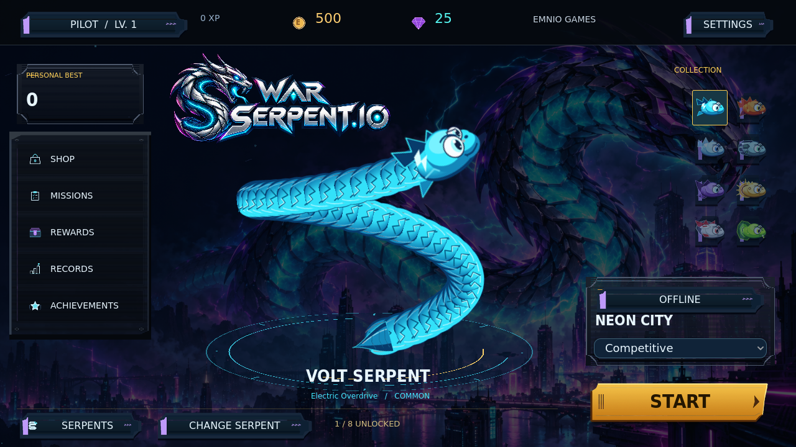

# War Serpent.io — Emnio Games — v1.2.0

A native Godot 4.6.3 Android serpent arena. English UI, eight distinct serpents, real offline AI, direct-connect multiplayer, synthwave music and persistent local progression.



## Download / install

- [Latest releases](https://github.com/heyninja67-png/WarSerpent-Game/releases)
- Application ID: `com.emnioggs.warserpent`.
- Android 7.0/API 24+, ARM64 or ARMv7, OpenGL ES 3; target API 36.
- Version 1.2.0, version code 3. The signing certificate is unchanged from v1.0.0, so install over the previous APK to retain your save. Do not uninstall first.
- Release-mode optimized engine export, signed with the existing development identity. This is a sideload build, not a Play Store release.

The current machine has no Android device/emulator. Read [BUILD_REPORT.md](BUILD_REPORT.md) for what was actually tested, benchmark limits, and APK verification.

## New in 1.2

- A new original War Serpent.io wordmark and serpent emblem, with matching Android icon.
- Game-style lobby: top profile/currencies, left feature navigation, a large coiled serpent on an animated podium, a live collection rail, and a gold START button at bottom right. Collection cards show ability timings; results and touch feedback stay functional.
- More responsive small-snake steering, joystick deadzone hysteresis and reliable input reset after pause/focus changes.
- Clearer spawn protection, power duration, pickups and arena-boundary warnings.
- Circular live minimap, compact time/score/leaderboard, grouped real power controls, a purple raised-block arena and eight glossy expressive serpent designs. Instanced rendering remains enabled.
- A new original Emnio Games studio logo and animated opening, without loading slogans.

## Included features

- Smaller starting snake; mass and length grow by collecting energy.
- Rendering and AI optimized, lower mobile Auto budget, cached sounds/UI resources and bounded effect/food pools. Actual before/after server measurements are in the performance report; they are not phone FPS guarantees.
- Full-bleed landscape, animated Emnio opening, no loading slogans, custom buttons, animated menu and paginated collection.
- All interface and catalog text in English. Defeat says **ELIMINATED**, not a connection error.
- Two original melodic synthwave tracks, separate music/effect settings, and additional feedback sounds.
- Eight playable identities and abilities: Volt Serpent (speed), Inferno Viper (area slow), Frost Fang (slow trail), Cyber Reaper (shield), Shadow Phantom (phase), Solar Wyrm (magnet), Neon Samurai (dash), Toxic Fang (cloud).
- Real ENet rooms for host plus up to three guests. No public automatic matchmaking server is bundled or deployed.
- Save v2 migrates previous inventory, coins, XP, settings and records without resetting progress.

## Controls

| Action | Android | Desktop |
|---|---|---|
| Steer | Left joystick | WASD/arrows or drag joystick |
| Boost | Hold BOOST | Space / hold BOOST |
| Ability | Power button | E / power button |
| Pause | Pause button / system Back | Esc/P |

## Multiplayer

Select ONLINE, then HOST ROOM or JOIN ROOM. On the same Wi-Fi, use the host device's local IP and the same UDP port (default 24680). Internet connections require a publicly reachable host/UDP port, typically port forwarding or your own server. Mobile-carrier NAT may prevent hosting. This is a direct connection mode, not simulated online bots.

The host owns movement, growth, food, cooldowns and collision outcomes; clients send inputs and interpolate snapshots. If the playing host leaves or ends its run, the room closes. There is no account service, online ranked economy or anti-cheat backend. See [docs/ONLINE.md](docs/ONLINE.md), including the optional headless host.

## Open / build

Install Godot **4.6.3** and open `project.godot`, then F5, or run `godot --path .`.

```sh
./tools/setup_android.sh
./tools/build_android.sh
python3 tools/validate_android.py
python3 tools/package_source.py
```

The setup reuses existing tools and installs only missing local dependencies, checking official checksums/TLS. The direct Android template route needs `java` and `keytool`, not Gradle, javac or an NDK. Source ZIP excludes SDK, templates, caches, saves and signing keys. See [toolchain notes](docs/toolchain_notes.md).

Default cloud paths: `/workspace/toolchains/android-sdk`, `/workspace/.config`, `/workspace/.local/share`, `/workspace/.cache`. Set `WARSERPENT_TOOLCHAINS`, `ANDROID_HOME`, `XDG_CONFIG_HOME`, `XDG_DATA_HOME`, `XDG_CACHE_HOME` to writable locations on another machine. Godot itself must already be installed.

On a fresh clone, the original private signing key is deliberately absent. Setup creates your own development key. To compile your own independently signed build, explicitly select its **public certificate fingerprint** before running the build helper:

```sh
export WARSERPENT_EXPECTED_CERT_SHA256="$(keytool -exportcert -keystore "${WARSERPENT_TOOLCHAINS:-/workspace/toolchains}/debug.keystore" -alias androiddebugkey -storepass android | sha256sum | cut -d ' ' -f 1)"
./tools/build_android.sh
```

This does not let a new key update the existing Emnio APK. Keeping the original fingerprint as the default prevents accidental incompatible updates in the maintained environment. Never copy a private signing key into the repository or source ZIP.

Install on an authorized device:

```sh
"$ANDROID_HOME/platform-tools/adb" install -r builds/WarSerpentIO-debug.apk
"$ANDROID_HOME/platform-tools/adb" shell am start -n com.emnioggs.warserpent/com.godot.game.GodotAppLauncher
```

The helper retains the filename `WarSerpentIO-debug.apk` for compatibility, even for the release-mode, development-signed export. Release downloads use a versioned filename.

## Tests

```sh
./tools/test.sh
```

Tests isolate save files under `/tmp`. Network tests launch actual local host/client processes; they do not prove Internet reachability or Android hardware compatibility. `tests/capture_screens.gd` captures real desktop framebuffers using `DISPLAY=:99` after `./tools/start_display.sh` in this environment.

## Source / licenses

Main components are under `scripts/{ui,gameplay,movement,bots,core,network}`. The eight identities and prices are in `data/catalog.json`. Assets are reusable PNG/OGG/WAV files. Programmatic assets/audio can be regenerated with `tools/generate_assets.py` and `tools/generate_audio.py`; the final image-generated background is already included.

Code: [MIT](LICENSE). Original artwork/audio: [asset provenance and licenses](assets/LICENSE.md). DejaVu fonts keep their original notice. Godot's MIT license and attributions are available in Settings → Credits and [THIRD_PARTY.md](docs/THIRD_PARTY.md).

Extra arenas, automatic public matchmaking, additional cosmetic economies and a 50-skin catalog remain future work. Current performance still needs profiling on actual low-end phones; rendering tests here use Linux software graphics.
